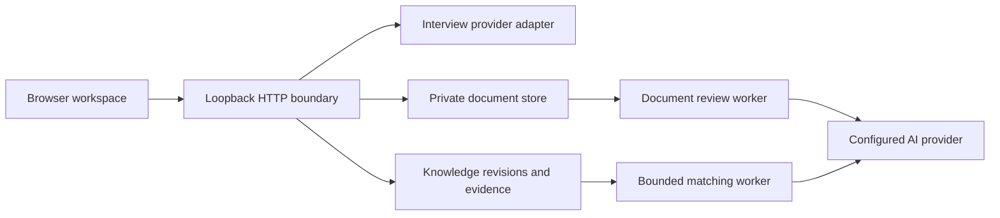

# Application audit — November 3, 2026

The audit covered the entire UI/UX and backend architecture, fixed reproduced defects, and repeated independent source review and integrated offline checks. All fifteen usability recommendations are implemented. No further concrete defects were found in the final reviewed scope; this is not a guarantee that software is free of bugs.

## Architecture and boundaries

The app is a local single-user prototype. The browser holds the editable conversation; explicit JSON export preserves it. Loopback HTTP serves the interface and authorizes requests through Host, Origin, CSRF and server-owned Admin checks. Provider credentials stay on the server. Uploaded originals and extracted sources remain local. Document review and cross-process matching receive selected, bounded context through injected provider adapters. SQLite retains knowledge revisions and review history.

Existing boundaries remain explicit: this is not a shared hosted service, production identity system, or independent verification of employee accounts. No user data, credentials, or actual business interviews are included in test fixtures.

## Audit coverage

| Area | Evidence and changes |
|---|---|
| Welcome, conversation, memo, transcript, Review and workflow | Existing desktop/phone screens and source inspected; searches, source return, path navigation and complete exports checked. File-purpose capture now follows the actual question and current file intent. |
| Saved interviews | Opening locks conflicting editing/uploads; fallible local fields are validated before replacement. Failed opening preserves the existing interview and unsent answer. Renaming alone no longer requests another AI extraction. |
| Browser/file lifecycle | Conflicting file actions are serialized; file discussion waits for an active reply. BFCache restoration replaces aborted controllers, ignores old responses and resumes status safely. Interrupted source reads offer retry. |
| Admin submissions and filters | Frozen attempts retain their key/body through a lost response. One active submission is admitted. Session and view epochs reject stale receipts and late administrative completions. System filters match the correct revision. |
| HTTP and launcher | Connections, header/body reading, upload concurrency and shutdown ordering are bounded. Failed construction and failed launch clean up only owned resources. Invalid ports fail before launch. |
| Evidence and knowledge persistence | Non-finite data and malformed workflow arrays are rejected; file events cannot become participant evidence. Revision types and shutdown/retry races are guarded. Request-intent idempotency is separated from mutable file analysis. |
| Knowledge performance | The public full-store snapshot is retired. Metadata, detail, histories, related routes, members and aliases use bounded server pages. A 107-account regression checks metadata without transcript reads; 703 review records remain reachable through pages. Matching scope/candidate filtering happens before file-source resolution. |
| Graph integrity | Latest-revision graph filters pair the correct submission/revision; a selected process excluded by filters cannot leak neighbors. Complete oversized graphs are refused with refinement controls. Confirmed temporal links have the correct direction in graph and downstream views; related stored-status limitations stay visible. |
| Accessibility and recovery | Selected tabs retain keyboard entry, modal/source return restores visible focus, mobile memo reparenting preserves navigation, and reduced-motion jumps avoid smooth scrolling. Literal Unicode search preserves text offsets. Malformed saved-file metadata fails before replacing the current interview; structured diagnostics remain readable in Review and Markdown. |
| Running builds | Public source fingerprints detect a stale backend without hashing private data or stopping an open interview. Startup checks accept only the requested build and clean up only the owned child process on failure. |
| Large documents and background work | Poll/worker scheduling is atomic; obsolete intents are removed. Storage error reporting cannot kill the worker. Revisit rereads the complete indexed content; unread/empty sources cannot claim complete review. Workbook formulas preserve meaningful text/metadata and readers close on initialization failure. |
| Live transport and animated presence | Source reviewed; narrow transport-send, recovery-timer, callback-isolation and caption chronology fixes made. Presence lifecycle reviewed and its deterministic visual checks run. Voice paths were not executed. |

## Verification policy and limits

Tests use synthetic fixtures, temporary storage, fake analyzers and local sockets. The browser review uses only the built-in fictional example. No new interview answers, file uploads to a provider, voice sessions, microphone/speaker access, or AI credits are used. Physical voice behavior and live model quality remain unverified. The Live controller changes receive syntax and source review only, respecting the existing voice-testing restriction.

Already-running parser/provider callbacks cannot be forcibly canceled by the current adapters. Document shutdown offers a short grace, prevents new analysis dispatch and suppresses late analysis publication. A process exit may still end a daemon parser; durable originals permit later recovery.

## Completion review and boundaries

The final offline run passed 368 checks with no failures or skips among executed checks. Independent reviewers rechecked authorization, revision/source identity, pagination/counts, graph scope/direction, async guards, imports, focus and recovery. Browser checks use a disposable fictional 33-process store and the bundled complete example; existing user interview tabs remain untouched.

Voice-specific suites, real provider calls, physical audio, full screen-reader certification, production hosting/identity, actual company-data scale and operational disaster recovery are outside this validation. Those limits remain explicit rather than being represented as passes. Offset pages can move under concurrent writes, and source status is checked on selected reads/actions rather than continuously. A chosen full submission may still contain its complete allowed transcript; the browser does not accumulate all submissions.

Commands, exact results, browser evidence and delivery status for each batch belong in [build verification](BUILD_VERIFICATION.md).
